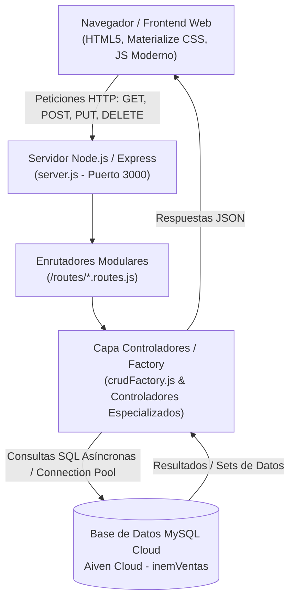
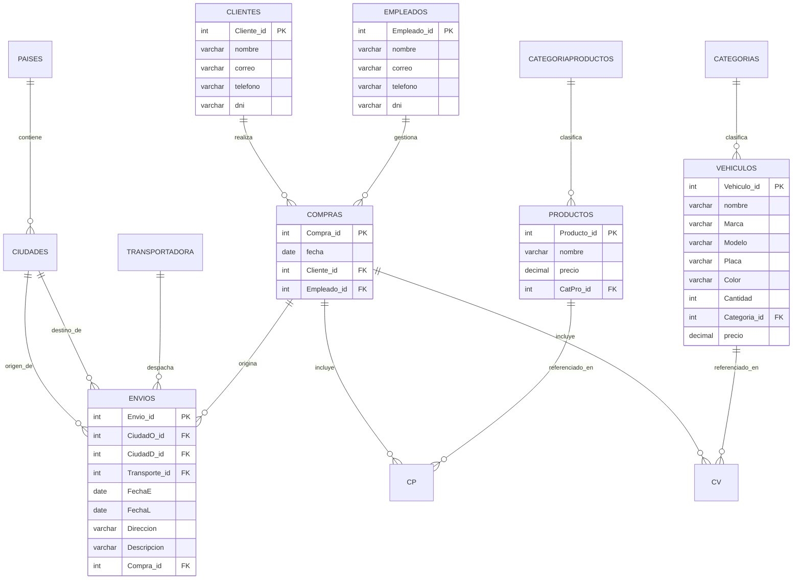
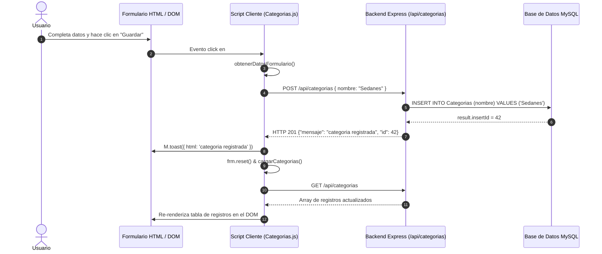

# Documentación Técnica Integral del Sistema INEM Ventas
**Manual de Arquitectura, Funcionamiento y Referencia de Código (8 Secciones / Páginas)**

---

## 📑 Índice de Contenidos

1. [Página 1: Visión General, Arquitectura del Sistema y Pila Tecnológica](#página-1-visión-general-arquitectura-del-sistema-y-pila-tecnológica)
2. [Página 2: Modelo de Datos, Persistencia y Conexión MySQL](#página-2-modelo-de-datos-persistencia-y-conexión-mysql)
3. [Página 3: Núcleo del Servidor Express, Middleware y Rutas Estáticas](#página-3-núcleo-del-servidor-express-middleware-y-rutas-estáticas)
4. [Página 4: El Patrón Arquitectónico CRUD Factory (`crudFactory.js`)](#página-4-el-patrón-arquitectónico-crud-factory-crudfactoryjs)
5. [Página 5: Módulos Especializados y Lógica de Negocio](#página-5-módulos-especializados-y-lógica-de-negocio)
6. [Página 6: Catálogo Completo de Endpoints RESTful de la API](#página-6-catálogo-completo-de-endpoints-restful-de-la-api)
7. [Página 7: Capa Cliente e Interacción Frontend (DOM, Fetch API, UX)](#página-7-capa-cliente-e-interacción-frontend-dom-fetch-api-ux)
8. [Página 8: Guía de Despliegue, Seguridad, Manejo de Errores y Mantenibilidad](#página-8-guía-de-despliegue-seguridad-manejo-de-errores-y-mantenibilidad)

---

# Página 1: Visión General, Arquitectura del Sistema y Pila Tecnológica

### 1.1 Introducción y Propósito del Sistema
El ecosistema de software **INEM Ventas** es una solución integral orientada a la administración de operaciones comerciales y logísticas para la comercialización de bienes y vehículos. La plataforma centraliza el registro de inventario (vehículos, repuestos y productos), la gestión de clientes y colaboradores (empleados), el control de compras comerciales y la administración de despacho logístico y transporte internacional/nacional.

El sistema se diseñó bajo una arquitectura **Cliente-Servidor desacoplada**, con una interfaz web orientada al usuario y un **Backend RESTful** construido con Node.js y Express que dialoga con una base de datos relacional MySQL en la nube.



### 1.2 Pila Tecnológica (Tech Stack)

| Capa | Componente | Versión / Detalle | Función Principal |
| :--- | :--- | :--- | :--- |
| **Entorno de Ejecución** | Node.js | v18+ LTS / CommonJS | Motor de ejecución del backend asíncrono no bloqueante |
| **Framework HTTP** | Express | `^5.2.1` | Gestión de pipeline de middlewares, enrutamiento y servicio estático |
| **Base de Datos** | MySQL 8.x / MySQL2 | `^3.22.4` | Conexión optimizada con Pool de conexiones y soporte nativo de Promises |
| **Seguridad de Red** | CORS | `^2.8.6` | Habilita el intercambio de recursos de origen cruzado para clientes web |
| **Variables de Entorno**| Dotenv | `^17.4.2` | Configuración y desacoplamiento de credenciales del entorno |
| **Desarrollo Activo** | Nodemon | `^3.1.14` | Hot-reloading y reinicio automático en entorno de desarrollo local |
| **Frontend Integrado** | HTML5 / Materialize CSS | Estándar W3C | Formularios interactivos, toasts de notificación y tablas de datos |

### 1.3 Estructura de Directorios del Repositorio

El proyecto mantiene una estructura modular y limpia donde cada responsabilidad de código está rigurosamente segmentada:

```text
backend-Inem-secundario/
├── config/
│   └── database.js               # Configuración del Pool MySQL2 y credenciales SSL
├── controllers/
│   ├── crudFactory.js            # Motor genérico generador de operaciones CRUD
│   ├── CategoriaProductos.controller.js # Controlador específico con validación
│   ├── Envios.controller.js      # Controlador de logística con lógica condicional
│   ├── vehiculos.controller.js   # Controlador de inventario vehicular
│   ├── productos.controller.js   # Controlador de inventario de repuestos/artículos
│   ├── Clientes.controller.js    # Gestión de compradores
│   ├── Empleados.controller.js   # Gestión de equipo interno
│   ├── Compras.controller.js     # Cabecera de transacciones comerciales
│   ├── CP.controller.js          # Relación Compra-Producto (Detalle)
│   ├── Cv.controller.js          # Relación Compra-Vehículo (Detalle)
│   ├── Categorias.controller.js  # Categorías generales
│   ├── Ciudades.controller.js    # Divisiones geográficas locales
│   ├── Paises.controller.js      # Países de origen y destino
│   └── transportadora.controller.js # Empresas de envíos y logística
├── routes/
│   └── *.routes.js               # Enrutadores Express que vinculan rutas con verbos HTTP
├── sql/
│   └── CategoriaProductos.sql    # DDL inicial y scripts de estructura de datos
├── package.json                  # Manifiesto de dependencias y scripts de ejecución
├── server.js                     # Punto de entrada, middlewares y bootstrap de la app
└── *.js (Raíz)                   # Scripts cliente/consumidores para formularios web
```

---

# Página 2: Modelo de Datos, Persistencia y Conexión MySQL

### 2.1 Configuración de Persistencia (`config/database.js`)
El backend utiliza la librería `mysql2/promise`, la cual permite ejecutar sentencias SQL estructuradas utilizando la sintaxis moderna `async / await` sin recurrir a funciones de retorno anidadas (*callback hell*).

El acceso a la base de datos se administra mediante un **Pool de Conexiones** (*Connection Pool*). En lugar de abrir y cerrar una conexión TCP por cada solicitud HTTP entrante (lo cual deterioraría el rendimiento y la latencia), el servidor mantiene un conjunto de conexiones calientes reutilizables.

```javascript
// config/database.js
const mysql = require('mysql2');

const pool = mysql.createPool({
    host: 'mysql-3b13f1f4-mysql-inemventas2026.h.aivencloud.com',
    port: 12803,
    user: 'avnadmin',
    password: '********************',
    database: 'inemVentas',

    waitForConnections: true,  // Encola solicitudes si todas las conexiones están en uso
    connectionLimit: 10,       // Límite máximo de 10 conexiones concurrentes
    queueLimit: 0,             // Cola infinita de espera sin descartar peticiones

    ssl: {
        rejectUnauthorized: false // Permite canal TLS seguro en servicios Cloud
    }
});

module.exports = pool.promise();
```

### 2.2 Diagrama Entidad-Relación (DER) del Sistema
El modelo de datos almacena los procesos de venta mediante una separación lógica entre compras de vehículos y compras de productos, integradas a un sistema logístico de envíos.



### 2.3 Diccionario de Entidades Principales

1. **`Clientes` & `Empleados`**: Entidades maestras de actores. Almacenan información de identificación fiscal (`dni`), datos de contacto (`correo`, `telefono`) y nombres completos.
2. **`Vehiculos`**: Catálogo de automóviles, motocicletas y maquinaria. Posee atributos automotrices: marca, modelo, número de placa único, color, existencias (`Cantidad`) y precio unitario.
3. **`Productos` & `CategoriaProductos`**: Inventario de consumibles, repuestos y accesorios complementarios catalogados por tipo.
4. **`Compras`, `CP` y `Cv`**: `Compras` representa la cabecera contable vinculando el cliente con el vendedor. `CP` (Compra-Producto) y `Cv` (Compra-Vehículo) son tablas pivote que desnormalizan la relación de muchos a muchos permitiendo transacciones comerciales complejas.
5. **`Envios`, `Transportadora`, `Ciudades` y `Paises`**: Estructura de distribución logística que registra la fecha de salida (`FechaE`), fecha de entrega (`FechaL`), dirección física, descripción de la encomienda y coordenadas urbanas.

---

# Página 3: Núcleo del Servidor Express, Middleware y Rutas Estáticas

### 3.1 Flujo de Arranque y Middleware Pipeline (`server.js`)
El archivo [server.js](file:///c:/Users/Aleja/Documents/backend-2.0/backend-Inem-secundario/server.js) coordina el ciclo de vida de la aplicación. Configura la pila de interceptores de solicitudes antes de enrutar las llamadas a los controladores de negocio.

```javascript
// Inicialización y Middlewares
const express = require('express');
const db = require('./config/database');
const path = require('path');
const cors = require('cors');

const app = express();

// Procesa cuerpos de solicitud con formato application/json hacia req.body
app.use(express.json());

// Provee cabeceras CORS (Access-Control-Allow-Origin: *)
app.use(cors());
```

### 3.2 Integración y Despliegue de Recursos Estáticos del Frontend
El servidor no solo opera como API de datos puros; también sirve de manera unificada los directorios del frontend administrativo y de gerencia:

```javascript
const raizFrontendPrincipal = path.resolve(__dirname, '../../paginaWebINEMVentas');
const raizFormularios = path.resolve(__dirname, '../../Front-2.0/front-Inem-secundario/INEM-VENTAS/front/Proyecto-inem-ventas-fronted');

// Assets visuales y logotipos
app.use('/branding', express.static(path.join(raizFrontendPrincipal, 'assets', 'branding')));

// Dashboard ejecutivo
app.get('/formularios-gerente.html', (req, res) => {
    res.sendFile(path.join(raizFrontendPrincipal, 'formularios-gerente.html'));
});

// Directorio completo de formularios del sistema
app.use('/formularios', express.static(raizFormularios));
```

### 3.3 Migraciones y Auto-reparación en el Arranque (`iniciarServidor`)
Un aspecto clave del diseño de [server.js](file:///c:/Users/Aleja/Documents/backend-2.0/backend-Inem-secundario/server.js) es su capacidad de inicialización idempotente. Antes de enlazar el puerto TCP 3000, valida el esquema de base de datos y aplica alteraciones estructurales si no existen:

```javascript
const iniciarServidor = async () => {
    // 1. Garantiza la existencia de la tabla crítica CategoriaProductos
    await db.query(`
        CREATE TABLE IF NOT EXISTS CategoriaProductos (
            CatPro_id INT NOT NULL AUTO_INCREMENT,
            nombre VARCHAR(150) NOT NULL,
            PRIMARY KEY (CatPro_id)
        )
    `);

    // 2. Comprobación e introspección de columnas en la tabla Envios
    const [columnasEnvios] = await db.query(`
        SELECT COLUMN_NAME
        FROM information_schema.COLUMNS
        WHERE TABLE_SCHEMA = DATABASE()
          AND TABLE_NAME = 'Envios'
          AND COLUMN_NAME = 'Descripcion'
    `);
    
    // Si la columna Descripcion fue omitida en despliegues previos, la agrega automáticamente
    if (columnasEnvios.length === 0) {
        await db.query('ALTER TABLE Envios ADD COLUMN Descripcion VARCHAR(255) NULL');
    }

    // 3. Inicio del socket de escucha HTTP
    app.listen(PORT, () => {
        console.log(`Servidor ejecutándose en puerto ${PORT}`);
    });
};
```

Este mecanismo previene excepciones en tiempo de ejecución causadas por desfases en el esquema de la base de datos en la nube.

---

# Página 4: El Patrón Arquitectónico CRUD Factory (`crudFactory.js`)

### 4.1 Principio DRY (Don't Repeat Yourself) y Metaprogramación
En sistemas empresariales que manejan múltiples tablas maestras, duplicar código para operaciones básicas (consultar todos, consultar por ID, insertar, actualizar y eliminar) genera cientos de líneas idénticas difíciles de mantener.

Para resolver esto, la solución implementa el patrón **Factory Method** en [controllers/crudFactory.js](file:///c:/Users/Aleja/Documents/backend-2.0/backend-Inem-secundario/controllers/crudFactory.js). Esta función de orden superior recibe la parametrización de una tabla y retorna un conjunto estandarizado de manejadores HTTP.

```javascript
const db = require('../config/database');

const createCrudController = ({ table, idColumn, fields, resource }) => {
    // Generador dinámico de métodos CRUD
    return { selectAll, selectById, create, update, remove };
};
```

### 4.2 Desglose Funcional de los Métodos del Factory

#### A. Consulta Global (`selectAll`)
```javascript
const selectAll = async (req, res) => {
    try {
        const [rows] = await db.query(`SELECT * FROM ${table}`);
        res.json(rows);
    } catch (error) {
        console.error(`Error al listar ${resource}:`, error);
        res.status(500).json({ mensaje: `Error al listar ${resource}` });
    }
};
```
- **Retorno:** HTTP 200 con el array serializado de registros.
- **Seguridad:** El nombre de la tabla se inyecta internamente en la inicialización (sin exposición a entradas directas de usuarios).

#### B. Consulta Puntual (`selectById`)
```javascript
const selectById = async (req, res) => {
    try {
        const [rows] = await db.query(
            `SELECT * FROM ${table} WHERE ${idColumn} = ?`,
            [req.params.id]
        );
        if (rows.length === 0) {
            return res.status(404).json({ mensaje: 'Registro no encontrado' });
        }
        res.json(rows[0]);
    } catch (error) {
        res.status(500).json({ mensaje: `Error al consultar ${resource}` });
    }
};
```
- **Protección SQL:** Hace uso de sentencias preparadas mediante el comodín `?`, lo que neutraliza vectores de ataque por **Inyección SQL**.
- **Control de Existencia:** Si el registro no existe, responde de forma semántica con el código de estado `HTTP 404 Not Found`.

#### C. Inserción Dinámica (`create`)
```javascript
const create = async (req, res) => {
    const values = fields.map((field) => req.body?.[field]);
    try {
        const [result] = await db.query(
            `INSERT INTO ${table} (${fields.join(', ')}) VALUES (${fields.map(() => '?').join(', ')})`,
            values
        );
        res.status(201).json({ mensaje: 'Registro creado', id: result.insertId });
    } catch (error) {
        res.status(500).json({ mensaje: `Error al crear ${resource}`, detalle: error.message });
    }
};
```
- **Mapeo de Campos:** Extrae automáticamente los atributos definidos en `fields` asegurando que valores ajenos o maliciosos no sean persistidos.
- **Respuesta:** Código `HTTP 201 Created` retornando el `insertId` autogenerado por el motor MySQL.

#### D. Actualización y Borrado (`update`, `remove`)
- Evalúan `result.affectedRows === 0` para determinar si el recurso existía antes de confirmar la operación, informando adecuadamente al cliente con `404` si el ID era inválido o `200` confirmando el éxito.

---

# Página 5: Módulos Especializados y Lógica de Negocio

No todos los recursos del sistema tienen comportamientos idénticos. Algunos módulos requieren validaciones estrictas o lógica de persistencia personalizada:

### 5.1 Controlador Específico de Categorías de Productos
El archivo [controllers/CategoriaProductos.controller.js](file:///c:/Users/Aleja/Documents/backend-2.0/backend-Inem-secundario/controllers/CategoriaProductos.controller.js) implementa validación a nivel de servidor sin delegar al factory estándar, asegurando integridad antes de tocar la base de datos:

```javascript
// Validación explícita de tipos y contenido
const crear = async (req, res) => {
    const { nombre } = req.body || {};

    if (typeof nombre !== 'string' || nombre.trim() === '') {
        return res.status(400).json({ mensaje: 'El campo nombre es obligatorio' });
    }

    try {
        const [resultado] = await db.query(
            `INSERT INTO ${TABLE} (nombre) VALUES (?)`,
            [nombre.trim()] // Sanitización de espacios en blanco
        );
        res.status(201).json({ mensaje: 'Registro creado', id: resultado.insertId });
    } catch (error) {
        res.status(500).json({ mensaje: 'Error al crear la categoría de producto', detalle: error.message });
    }
};
```

### 5.2 Controlador Polimórfico de Envíos (`Envios.controller.js`)
El módulo de logística combina el `crudFactory` base con un mecanismo de sobreescritura condicional en el método `actualizar`:

```javascript
// controllers/Envios.controller.js
const crud = createCrudController({
    table: 'Envios',
    idColumn: 'Envio_id',
    fields: ['CiudadO_id', 'CiudadD_id', 'Transporte_id', 'FechaE', 'FechaL', 'Direccion', 'Compra_id'],
    resource: 'envío'
});

async function actualizar(req, res) {
    // Si la petición no incluye el campo dinámico "Descripcion", delega al factory estándar
    if (!Object.prototype.hasOwnProperty.call(req.body || {}, 'Descripcion')) {
        return crud.update(req, res);
    }

    // Si "Descripcion" está presente en el payload, ejecuta la consulta extendida
    const valores = camposEnvio.map(campo => req.body?.[campo]);
    const [resultado] = await db.query(
        `UPDATE Envios SET ${camposEnvio.map(campo => `${campo} = ?`).join(', ')}, Descripcion = ? WHERE Envio_id = ?`,
        [...valores, req.body.Descripcion, req.params.id]
    );
    // ...
}
```

### 5.3 Módulo de Vehículos (`vehiculos.controller.js`)
Configurado a través de `crudFactory` para administrar los 8 campos necesarios del parque automotor:
```javascript
const crud = createCrudController({
    table: 'Vehiculos',
    idColumn: 'Vehiculo_id',
    fields: ['nombre', 'Marca', 'Modelo', 'Placa', 'Color', 'Cantidad', 'Categoria_id', 'precio'],
    resource: 'vehículo'
});
```

---

# Página 6: Catálogo Completo de Endpoints RESTful de la API

La API expone un conjunto balanceado y homogéneo de rutas bajo el prefijo `/api/`. Todos los endpoints intercambian cargas útiles en formato JSON.

### 6.1 Matriz de Rutas y Métodos HTTP

| Recurso | Ruta Base | Métodos Disponibles | Parámetro ID | Campos Requeridos en Body (POST / PUT) |
| :--- | :--- | :--- | :--- | :--- |
| **Categorías Productos** | `/api/categoriaProductos` | `GET, POST, PUT, DELETE` | `:id` | `nombre` |
| **Categorías Vehículos** | `/api/categorias` | `GET, POST, PUT, DELETE` | `:id` | `nombre` |
| **Países** | `/api/paises` | `GET, POST, PUT, DELETE` | `:id` | `nombre` |
| **Ciudades** | `/api/ciudades` | `GET, POST, PUT, DELETE` | `:id` | `nombre, Pais_id` |
| **Transportadoras** | `/api/transportadoras` | `GET, POST, PUT, DELETE` | `:id` | `nombre` |
| **Clientes** | `/api/clientes` | `GET, POST, PUT, DELETE` | `:id` | `nombre, correo, telefono, dni` |
| **Empleados** | `/api/empleados` | `GET, POST, PUT, DELETE` | `:id` | `nombre, correo, telefono, dni` |
| **Productos** | `/api/productos` | `GET, POST, PUT, DELETE` | `:id` | `nombre, precio, CatPro_id` |
| **Vehículos** | `/api/vehiculos` | `GET, POST, PUT, DELETE` | `:id` | `nombre, Marca, Modelo, Placa, Color, Cantidad, Categoria_id, precio` |
| **Compras** | `/api/compras` | `GET, POST, PUT, DELETE` | `:id` | `fecha, Cliente_id, Empleado_id` |
| **Detalle Compra-Prod** | `/api/cp` | `GET, POST, PUT, DELETE` | `:id` | `Compra_id, Producto_id` |
| **Detalle Compra-Veh** | `/api/cv` | `GET, POST, PUT, DELETE` | `:id` | `Compra_id, Vehiculo_id` |
| **Envíos Logísticos** | `/api/envios` | `GET, POST, PUT, DELETE` | `:id` | `CiudadO_id, CiudadD_id, Transporte_id, FechaE, FechaL, Direccion, Compra_id, [Descripcion]` |

### 6.2 Códigos de Estado y Respuestas HTTP Estándar

```text
200 OK                  -> Solicitud GET exitosa, o PUT/DELETE procesados correctamente.
201 Created             -> Registro insertado exitosamente (retorna {"id": <insertId>}).
400 Bad Request         -> Datos obligatorios faltantes o tipos de datos incompatibles.
404 Not Found           -> El ID especificado en la URL no existe en la base de datos.
500 Internal Server Err -> Error no capturado en la base de datos o fallo en el servidor.
```

---

# Página 7: Capa Cliente e Interacción Frontend (DOM, Fetch API, UX)

En la raíz del proyecto y en el frontend secundario existen scripts cliente (`Categorias.js`, `vehiculos.js`, `productos.js`, `Envios.js`, etc.) que demuestran la interacción de interfaz de usuario con la API.

### 7.1 Flujo de Envío de Formularios (Creación / Actualización)
El frontend implementa un flujo reactivo asíncrono haciendo uso de la API nativa de JavaScript `fetch`:



### 7.2 Lógica de Edición y Eliminación en el DOM
Los clientes web manejan transiciones de estado en la interfaz mediante variables de alcance:

```javascript
let idSeleccionado = null; // Almacena el ID del registro en edición

// Carga en el formulario los datos de la fila seleccionada
function seleccionarParaEditar(registro) {
    idSeleccionado = registro.Categoria_id;
    document.getElementById("nombre").value = registro.nombre;
    document.getElementById("btnGuardar").style.display = "none";
    document.getElementById("btnActualizar").style.display = "inline-block";
}

// Envío de actualización con PUT
document.getElementById("btnActualizar").addEventListener("click", async () => {
    if (!idSeleccionado) return;
    const datos = obtenerDatosFormulario();
    const respuesta = await fetch(`${API}/${idSeleccionado}`, {
        method: "PUT",
        headers: { "Content-Type": "application/json" },
        body: JSON.stringify(datos)
    });
    if (respuesta.ok) {
        notificar("Actualizado correctamente");
        cancelarEdicion();
        cargarCategorias();
    }
});
```

---

# Página 8: Guía de Despliegue, Seguridad, Manejo de Errores y Mantenibilidad

### 8.1 Procedimiento de Despliegue y Ejecución

#### Prerrequisitos
1. **Node.js**: Versión 18.x o superior instalada.
2. **Acceso de Red**: Conectividad al host de base de datos MySQL en el puerto TCP `12803`.

#### Pasos de Instalación
```bash
# 1. Posicionarse en el directorio del backend
cd backend-Inem-secundario

# 2. Instalar dependencias exactas
npm install

# 3. Iniciar el servidor en modo desarrollo (con recarga automática)
npm run dev

# 4. Iniciar en modo producción
npm start
```

### 8.2 Análisis de Seguridad y Buenas Prácticas Implementadas
1. **Prevención de Inyección SQL**: Todas las consultas parametrizadas usan `?` con arrays de valores, lo que impide que comandos SQL externos sean evaluados como código ejecutable.
2. **CORS Configurado**: Permite conectar aplicaciones web front-end hospedadas en orígenes y dominios desacoplados.
3. **Manejo Centralizado de Excepciones**: Los bloques `try/catch` dentro de `crudFactory` previenen caídas inesperadas del proceso (`process crash`) ante errores de red o restricciones de clave foránea en MySQL.

### 8.3 Recomendaciones de Evolución y Escalabilidad Futura

1. **Variables de Entorno (`.env`)**:
   - Actualmente las credenciales de la base de datos están escritas de forma explícita en `config/database.js`. Se recomienda migrarlas a variables de entorno mediante el paquete `dotenv` ya instalado:
     ```javascript
     host: process.env.DB_HOST || 'localhost',
     password: process.env.DB_PASSWORD,
     ```
2. **Capa de Autenticación y Autorización**:
   - Incorporar tokens **JWT** (*JSON Web Tokens*) para proteger las rutas de escritura (`POST`, `PUT`, `DELETE`), restringiendo operaciones críticas a roles autorizados (e.g., Administrador o Gerente).
3. **Paginación en Consultas Masivas**:
   - En tablas con alto volumen de crecimiento como `Envios` o `Compras`, modificar el método `selectAll` de `crudFactory.js` para admitir parámetros `?limit=50&offset=0` para optimizar el consumo de memoria en la red y el cliente.

---
*Fin de la Documentación Oficial — Sistema INEM Ventas*
